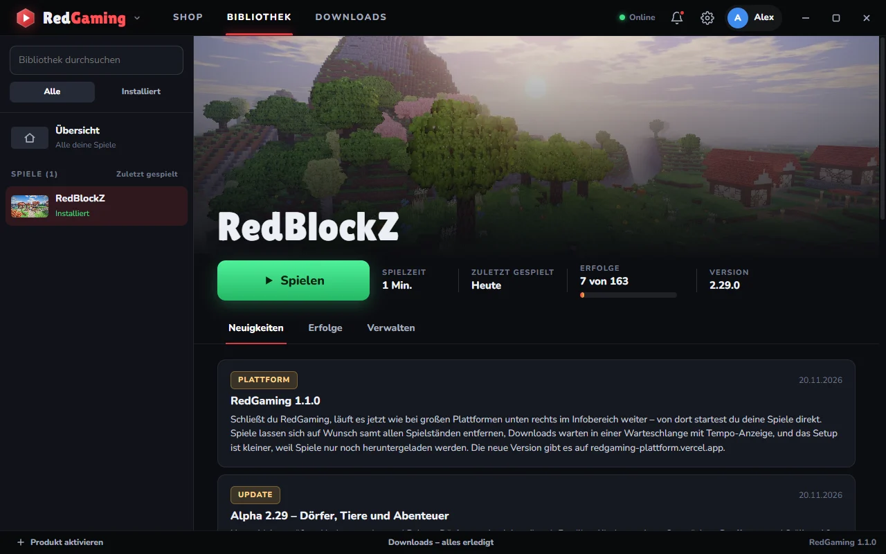
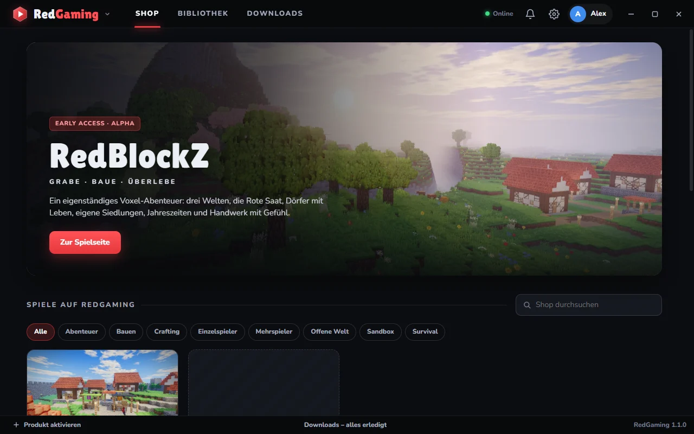
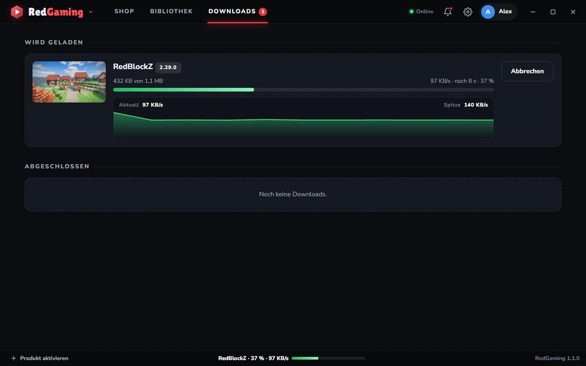
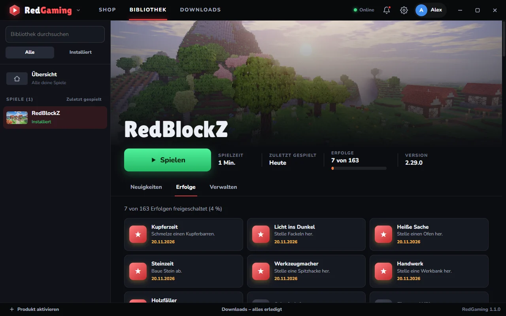

<h1 align="center">RedGaming</h1>

<b>Deine Spiele. Ein Zuhause.</b> Die Spieleplattform für RedBlockZ und alle kommenden Spiele.

<a href="https://github.com/DEIN-NAME/redgaming/releases/latest/download/RedGaming-Setup.exe"><b>⬇ RedGaming herunterladen</b></a> · <a href="https://redgaming-plattform.vercel.app">Website</a> · <a href="https://redblockz.vercel.app">RedBlockZ</a>

## Was RedGaming kann

- **Bibliothek** – alle Spiele an einem Ort, mit Übersicht, „Zuletzt gespielt“, Spielzeit und Erfolgen
- **Downloads und Updates** – mit Warteschlange, Tempo-Grafik und Prüfsumme; Updates mit einem Klick
- **Erfolge** – was du im Spiel erspielst, erscheint mit Datum in RedGaming
- **Läuft im Hintergrund** – wie bei Steam bleibt RedGaming unten rechts im Infobereich
- **Volle Kontrolle** – Speicherort wählen, Dateien prüfen, deinstallieren oder samt Spielständen vollständig entfernen
- **Kein Konto** – Profil, Schlüssel und Spielstände bleiben auf deinem PC

## Herunterladen

Die neueste Version gibt es immer unter **[Releases](https://github.com/DEIN-NAME/redgaming/releases/latest)**.
Für Windows 10 und 11 (64 Bit). Spiele schaltest du mit deinem persönlichen Produktschlüssel frei.

---
RedGaming ist ein privates Projekt in der Testphase. Dieses Projekt enthält nur die Downloads – keinen Quellcode.
